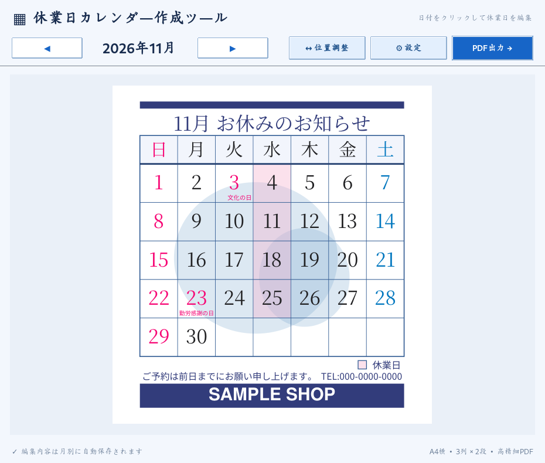

# 休業日カレンダー作成ツール

Python製のデスクトップアプリケーション。店舗の休業日をマウスで編集し、**A4横・3列×2段に同一カレンダー6枚**を配置したPDFを出力します。

**このリポジトリはポートフォリオ公開用の匿名デモ版（v1.12）です。** 店舗名・電話番号・ロゴ・休業日設定は架空のサンプルに置き換えています。実店舗のデータは含みません。



[PDF出力見本](docs/PDF出力見本.pdf) ｜ [一般利用者向けの操作説明書](使い方.html)

## 主な機能

- カレンダーを1枚だけ表示し、日付クリックで休業日を編集・月別保存
- 日付クリック時は必要な表示範囲のみ更新し、操作時の描画負荷を抑制
- 内閣府の祝日CSVデータの取得・キャッシュ、オフライン時の代替データ
- 祝日名称をセル内に表示し、休業日は半透明ピンク色で表現
- 背景ロゴの色・彩度・明度・不透明度の変更、リアルタイムプレビュー
- 6面付けのPDFプレビュー、裁断マークの表示切替
- 左・中央・右列の横移動と、上・下段の縦移動をmm単位で調整
- 保存場所の変更、既存データの移行・衝突時の保護
- Windows用EXEの生成スクリプト（Windows実機でのビルドが必要）

## 開発環境・技術

- Python 3系、Tkinter（GUI）
- PyMuPDF（PDF生成とベクター描画）、Pillow（画面描画）
- JSON（設定・休業日保存）、CSV（祝日データ）
- PyInstaller（Windows配布版のビルド）

## Windowsでの起動

PowerShellまたはVS Codeのターミナルで、展開したフォルダに移動して実行します。

```powershell
py -m venv .venv
.\.venv\Scripts\python.exe -m pip install -r requirements.txt
.\.venv\Scripts\python.exe store_calendar.py
```

カレンダーのPDFのみ生成する場合：

```powershell
.\.venv\Scripts\python.exe store_calendar.py --demo --year 2026 --month 11 --output demo.pdf
```

## テスト

```powershell
.\.venv\Scripts\python.exe -m unittest discover -s tests -v
```

**動作確認済みの範囲**：開発環境で自動テスト14項目が成功。Windows実機でのEXE生成、異なるPCでの印刷、フォントの完全一致は別途検証が必要です。

## Windows用EXEの作成（任意）

Windows上で`build_exe.bat`を実行します。PyInstallerを使い、`dist/`に実行ファイルと配布用ZIPを生成します。**このリポジトリには生成済みEXEを含めません。** 一部の日本語書体はPCのインストール済みフォントを使用するため、出力先のPCによって見え方が変わる場合があります。

## 構成

```text
store-holiday-calendar/
├── store_calendar.py      # アプリ本体（コメント付き）
├── requirements.txt       # 実行用ライブラリ
├── build_exe.bat          # Windows用EXE作成の起動ファイル
├── build_windows.py       # EXE作成処理
├── 使い方.html             # 操作説明書（画面画像を内蔵）
├── README.md
├── .gitignore
├── assets/                 # 架空のロゴ・背景・内蔵祝日データ
├── docs/                   # 匿名の画面見本・PDF見本
└── tests/                  # 自動テスト
```

`.venv/`、`data/`、`build/`、`dist/`、PDFの任意出力ファイルはGit管理対象外です。実行時に作られる`data/`には、休業日・設定などが格納されます。誤公開を防ぐためコミットしないでください。

## AIを活用した開発について

本プロジェクトは、AIを活用した要件整理・実装支援・検証を通じて制作しました。ユーザー側で行った仕様提示、画面の使い勝手に対するフィードバック、修正要望をもとに改良を重ねています。ソースの実装やテストをAIが支援した部分と、自分自身で実施した作業は、面接等で区別して説明する方針です。

## 公開時の注意

- 本リポジトリは匿名サンプル用素材のみを収録しています。実店舗の素材・データを追加しないでください。
- フォントファイルは同梱していません。外部フォントのライセンスは各自確認してください。
- この配布には明示的なソフトウェアライセンスを付けていません。ライセンスの選択は公開前に検討してください。
- 祝日情報は [内閣府「国民の祝日について」](https://www8.cao.go.jp/chosei/shukujitsu/gaiyou.html) を参照します。
